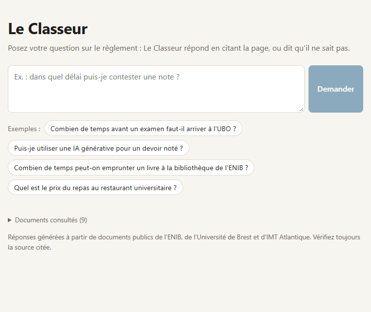
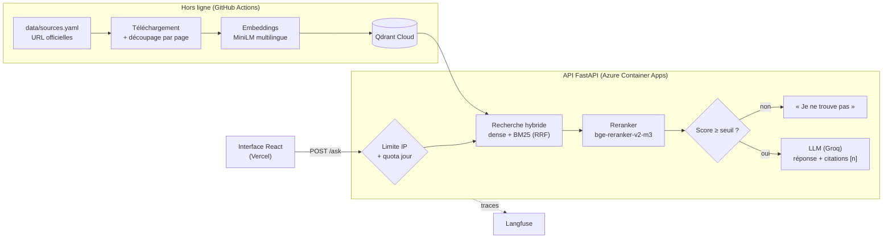

# Le Classeur

**Posez votre question sur le règlement : Le Classeur répond en citant la page, ou dit qu'il ne sait pas.**

[Démo en ligne](https://policy-binder.vercel.app) · [Rapport d'évaluation](docs/evaluation.md) · [Journal de bord](JOURNAL.md) · [Explications par étape](docs/explications/)



## Problème
Dans une banque, une assurance, une ESN ou un établissement public, les règles internes (règlement intérieur, procédures, chartes informatiques, règles d'examen) sont réparties dans des dizaines de PDF. Pour savoir « dans quel délai contester une note » ou « si l'on peut utiliser une IA générative pour un rapport », un collaborateur ouvre plusieurs documents, sollicite un service support (RH, scolarité, DSI, juridique), et obtient parfois une réponse fausse.

Un assistant conversationnel peut réduire ce coût, mais **un assistant qui invente une règle est pire que pas d'assistant**. Le Classeur est construit autour de deux exigences mesurées :
- chaque réponse cite la page exacte du document officiel ;
- quand l'information n'est pas dans les documents, il le dit.

## Approche
- **Corpus** : 9 documents publics de l'ENIB / Bretagne INP, de l'Université de Brest et d'IMT Atlantique (règlements, règles d'examens et de scolarité, chartes du numérique et de l'IA). Ils jouent le rôle de politiques internes. Le dépôt ne versionne que les URL officielles ; les PDF sont téléchargés par script.
- **Ingestion** : texte extrait page par page, puis découpé en 546 passages qui ne traversent jamais une page, pour que chaque citation renvoie à une page précise.
- **Recherche en deux étages** :
  - recherche hybride : embeddings multilingues dans Qdrant et BM25, fusionnés par rang (RRF) ;
  - reranking des 20 candidats par un cross-encoder multilingue exécuté en local.
- **Réponse** : un LLM (`gpt-oss-120b` via Groq, derrière une interface `LLMProvider`) répond uniquement à partir des 5 passages retenus et cite chaque affirmation par [n].
- **Abstention à deux niveaux** :
  - un seuil sur le score du reranker, calibré sur un jeu de questions séparé, s'abstient sans appeler le LLM ;
  - le LLM s'abstient aussi si les passages ne suffisent pas.
- **Questions sur plusieurs établissements** (« … à l'UBO et à l'ENIB ? ») : candidats réservés à chaque établissement, réponse partie par partie, et mention explicite de la partie absente des documents. Sur 8 questions composées, 8 parties sur 10 sont répondues avec leur citation (1 sur 10 avant), et les 7 parties absentes des documents sont signalées comme telles.
- **Évaluation** : 60 questions écrites comme un utilisateur et validées à la main (40 avec réponse, 20 hors corpus), un juge LLM d'une autre famille de modèles et des intervalles de confiance. Un sous-ensemble de 20 questions tourne en CI et bloque sous des seuils fixés à l'avance.
- **Production** :
  - API FastAPI conteneurisée sur Azure Container Apps (Terraform, déploiement GitHub Actions sans mot de passe par OIDC), index sur Qdrant Cloud, interface React sur Vercel ;
  - traces Langfuse de chaque question ;
  - limite de 10 questions par IP sur 10 minutes et de 300 par jour.

## Architecture


## Résultats mesurés
Sur les 60 mêmes questions, avec le même modèle et le même juge. IC = intervalle de confiance à 95 %. Les résultats sont exploratoires : 40 questions avec réponse donnent des intervalles larges. Protocole complet dans [docs/evaluation.md](docs/evaluation.md).

| | Base naïve (dense seule) | Hybride (dense + BM25) | **Version finale** (hybride + reranker + seuil) |
|---|---|---|---|
| Exactitude | 42,5 % (IC 29–58 %) | 47,5 % (IC 33–63 %) | **70,0 % (IC 55–82 %)** |
| Correct ou partiel | 57,5 % | 70,0 % | **95,0 %** |
| Réponses incorrectes (sur 40) | 2 | 3 | **0** |
| Refus injustifiés | 37,5 % | 22,5 % | **5,0 %** |
| Abstention sur questions hors corpus | 20/20 | 20/20 | **20/20** (15 sans appel au LLM) |
| Bonne page parmi les passages fournis | 62,5 % | 80,0 % | **95,0 %** |
| Coût pour 1 000 questions (tarif public Groq) | 0,31 $ | 0,31 $ | **0,25 $** |

**Latence de la démo en ligne** (6 questions, 16/10/2026) : médiane **8,2 s**, maximum 8,6 s, et environ 12,5 s pour la première question après une période sans visite. Les traces montrent qu'elle vient presque entièrement du reranker sur CPU (environ 1 s pour la génération).

**Évaluation en CI** : 13/14 réponses correctes ou partielles, 6/6 abstentions et 0 réponse incorrecte au premier passage, dans les seuils.

## Démo
- Interface : **https://policy-binder.vercel.app**. Questions d'exemple incluses : posez aussi une question hors des documents pour voir l'abstention.
- API : `GET /health`, `GET /sources`, `POST /ask {"question": "..."}` sur https://policy-binder-api.proudwave-dcc521c6.francecentral.azurecontainerapps.io
- Démo limitée à 10 questions par adresse sur 10 minutes et à 300 par jour. L'API s'éteint sans visite : la première question peut prendre une quinzaine de secondes.

## Lancer en local
Prérequis : Python 3.12 avec [uv](https://docs.astral.sh/uv/), et une clé Groq gratuite dans un fichier `.env` (`LLM_API_KEY=…`, voir `.env.example`).
```bash
uv sync
uv run python scripts/prepare.py
uv run uvicorn policy_binder.api:app
```
Puis `cd frontend && npm install && npm run dev` pour l'interface, sur http://localhost:5173.

## Limites et suite
- **Latence** de 8 s sur CPU, à cause du reranker. Pistes à mesurer : GPU, reranker plus petit, passages plus courts. Un réglage « rapide » testé (passages tronqués) faisait perdre tout le gain de qualité.
- **Jeu d'évaluation modeste** (60 questions sur 9 documents publics) ; un jeu jamais vu, idéalement de vraies questions d'utilisateurs, confirmerait les chiffres. Le passage au réglage complet du reranker a été décidé après avoir vu le jeu de test (voir le rapport).
- **Hébergement** : Azure Container Apps (crédits étudiants) au lieu de Google Cloud Run, faute de compte de facturation. Le Terraform Cloud Run est prêt et validé en CI (`infra/terraform`).
- **Questions à plusieurs sujets** : seuls les établissements déclenchent la recherche partie par partie ; « vitesse et animaux » n'est pas découpée.
- **Quota gratuit partagé** : la démo et les évaluations utilisent la même offre gratuite de Groq (200 000 jetons par jour pour le modèle). Le 17/10, deux évaluations complètes l'ont épuisé ; la démo répond alors aussitôt « réessayez dans quelques minutes » au lieu de rester en attente.
- **Limites de la démo en mémoire**, sur une seule instance ; un stockage partagé (Redis) serait nécessaire pour monter en charge.
- **Suite** :
  - relire un échantillon des verdicts du juge ;
  - suivre la qualité en production à partir des traces (scores Langfuse) ;
  - mise à jour automatique du corpus quand un établissement publie une nouvelle version d'un document, détectée par l'empreinte SHA-256.

## Dans le dépôt
| Dossier | Contenu |
|---|---|
| `src/policy_binder/` | Ingestion, index, BM25, recherche hybride, reranker, RAG, API, limites, traces |
| `eval/` | Jeu de test, jeu de calibration, sous-ensemble et seuils CI, résultats |
| `scripts/` | Téléchargement, ingestion, index, évaluations, calibration |
| `frontend/` | Interface React + Vite + TypeScript |
| `infra/azure/`, `infra/terraform/` | Terraform Azure Container Apps (utilisé) et Cloud Run (prêt) |
| `docs/` | Rapport d'évaluation, une fiche d'explication par étape, visuels |
