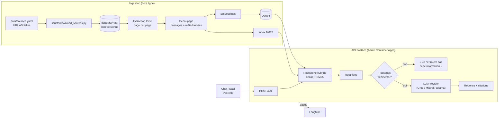

# SPEC — Le Classeur : assistant documentaire fiable et évalué

## Problème et coût pour une entreprise
Dans une banque, une assurance, une ESN ou un établissement public, les règles internes (règlement intérieur, procédures, chartes, politiques RH ou informatiques) sont réparties dans des dizaines de PDF. Un collaborateur qui cherche « combien de temps ai-je pour contester une note ? » ou « ai-je le droit d'utiliser une IA générative pour ce rapport ? » ouvre plusieurs documents, demande à un collègue ou au service concerné, et obtient parfois une réponse fausse.
Le coût : du temps perdu à chercher, des sollicitations répétées des services support (RH, scolarité, DSI, juridique) et des décisions prises sur une règle mal lue. Un assistant conversationnel peut réduire ce coût, mais **un assistant qui invente une règle est pire que pas d'assistant** : il faut qu'il cite ses sources et qu'il sache dire « je ne sais pas ».

## Utilisateurs
- Collaborateurs (ici : étudiants et personnels) qui posent des questions sur les règles internes.
- Services support, qui veulent moins de questions répétitives et des réponses vérifiables.
- Équipe IA, qui doit prouver la fiabilité de l'assistant avant de le mettre en production.

## Périmètre
- Ingestion PDF/Markdown → extraction du texte page par page → découpage en passages avec métadonnées (document, page) → embeddings → index Qdrant (local en développement, Qdrant Cloud en production).
- Recherche dense (base naïve), puis recherche hybride (dense + BM25) et reranking.
- Réponse générée par un LLM derrière l'interface `LLMProvider` avec citations des passages utilisés. Fournisseur par défaut : Groq (offre gratuite, modèles open-weight) ; l'API Mistral et Ollama (local) passent par la même classe. Décision du 12/10/2026 : l'offre gratuite de Mistral ne donne plus accès à l'API.
- Abstention explicite quand l'information n'est pas dans les documents.
- API FastAPI, interface de chat (React + Vite + TypeScript sur Vercel), traces Langfuse.
- Démo publique protégée (limite de requêtes par IP + quota quotidien).

## Hors périmètre
Kubernetes, ArgoCD (démontrés en P4), multi-tenant, authentification, mise à jour automatique du corpus, documents non publics.

## Architecture

## Données
Documents institutionnels publics, téléchargés depuis les sites officiels (liste exacte, URL et date de consultation dans `data/sources.yaml`) :
- ENIB / Bretagne INP : règlement intérieur de Bretagne INP ; informations sur les droits d'inscription 2025.
- Université de Brest (UBO) : charte du numérique 2026 ; charte d'utilisation de l'IA générative 2026 ; charte des examens ; guide des études en master (faculté Segalen) ; régime des études en licence (faculté Droit, Économie-Gestion, AES).
- IMT Atlantique / Institut Mines-Télécom : règlement intérieur d'IMT Atlantique (avril 2024) ; charte informatique de l'IMT (annexe 1 du règlement intérieur).
Les PDF ne sont pas versionnés (`data/raw/` est dans `.gitignore`) : le dépôt contient seulement les URL et le script qui les télécharge.

## Protocole d'évaluation
- Jeu de test : `eval/questions.jsonl`, 60 questions rédigées à partir du corpus et validées par Francis — 40 avec une réponse de référence et la source attendue (document + page), 20 hors corpus dont la bonne réponse est l'abstention.
- Métriques :
  - exactitude des réponses (juge LLM qui compare à la réponse de référence) et vérification que les citations pointent vers la source attendue ;
  - précision du contexte récupéré (la source attendue est-elle dans les k passages récupérés) ;
  - taux d'abstention correcte (questions hors corpus) ;
  - taux de refus injustifiés (abstention sur une question qui a une réponse) ;
  - latence p50 et p95 de bout en bout ;
  - coût estimé pour 1 000 questions (tokens facturés × tarif public).
- Comparaison : base naïve (recherche dense seule) vs version finale (hybride + reranking + abstention calibrée), sur le même jeu.
- Prudence : 60 questions sur 9 documents donnent des résultats **exploratoires**. Les intervalles d'incertitude sont donnés et le jeu de test n'est pas utilisé pour régler les seuils sans le signaler.
- CI : un sous-ensemble fixe de 20 questions bloque la fusion sous un seuil ; l'évaluation complète tourne à chaque tag de version.

## Definition of Done
1. Dépôt public, README « étude de cas » (Problème → Approche → Architecture → Résultats mesurés → Démo GIF + URL → Lancer en local en 3 commandes → Limites et suite).
2. Tests et CI verts ; évaluation sur 20 questions en CI, bloquante sous le seuil ; évaluation complète sur tag.
3. API déployée via Terraform, front sur Vercel, URL publique fonctionnelle. Cible initiale : Cloud Run ; hébergement réel : Azure Container Apps (Azure for Students), faute de compte de facturation Google Cloud — le Terraform Cloud Run reste prêt et validé en CI (décision du 16/10/2026).
4. `docs/evaluation.md` : protocole, jeu de test, résultats, comparaison avec la base naïve.
5. `docs/explications/` : une fiche par ticket.
6. JOURNAL.md : entrée « LIVRÉ » avec les 3 chiffres clés et l'URL de démo.
