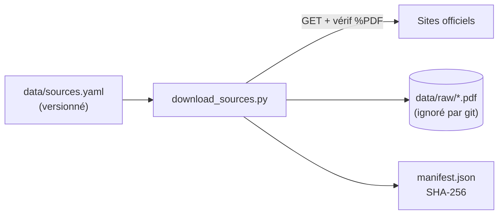

# P1-01 — Sources officielles et téléchargement

## Ce qui a été fait
- `data/sources.yaml` : 9 documents publics (ENIB / Bretagne INP, Université de Brest, IMT Atlantique / Institut Mines-Télécom), avec identifiant, titre, institution, type, URL officielle et date de consultation. Chaque URL a été vérifiée le 11/10/2026 (HTTP 200, `application/pdf`).
- `src/policy_help_desk/sources.py` : modèle Pydantic `Source`, chargement validé (identifiants uniques), téléchargement qui refuse tout contenu qui ne commence pas par `%PDF`.
- `scripts/download_sources.py` : télécharge tous les PDF dans `data/raw/`, écrit un `manifest.json` avec l'empreinte SHA-256 de chaque fichier, renvoie un code d'erreur si une source échoue.
- `data/raw/` est dans `.gitignore` : les PDF ne sont jamais versionnés.
- Tests : validité du fichier versionné, rejet des doublons, téléchargement simulé (`httpx.MockTransport`), rejet d'une page d'erreur HTML.

## Pourquoi ce choix plutôt que l'alternative courante
L'alternative courante est de copier les PDF dans le dépôt. Problèmes : droits de diffusion des documents des établissements, dépôt alourdi, et aucune trace de l'origine ni de la date de la version utilisée. Ici, le dépôt versionne la **référence** (URL + date) et le **moyen de reproduire** (script), comme on le ferait avec des données d'entreprise qu'on n'a pas le droit de copier. L'empreinte SHA-256 permet de détecter qu'un établissement a remplacé un document derrière la même URL : l'évaluation doit alors être relancée.

## Schéma

## 5 questions d'entretien
1. **Pourquoi ne pas versionner les PDF ?**
   Ce ne sont pas mes documents : je n'ai pas à les redistribuer, et un dépôt n'est pas un stockage de fichiers binaires. Je versionne l'URL, la date de consultation et le script : n'importe qui reconstruit le même corpus.
2. **À quoi sert l'empreinte SHA-256 du manifeste ?**
   À savoir si le document téléchargé aujourd'hui est le même que celui qui a servi à construire le jeu d'évaluation. Si l'empreinte change, les réponses de référence peuvent être fausses : on relance l'évaluation et on revérifie les questions concernées.
3. **Pourquoi vérifier que le contenu commence par `%PDF` alors que le serveur répond 200 ?**
   Beaucoup de sites renvoient une page HTML (erreur, consentement, redirection) avec un code 200. Sans ce contrôle, on indexerait une page d'erreur et l'assistant répondrait à partir de ce texte.
4. **Pourquoi Pydantic pour un simple fichier YAML ?**
   Pour échouer tôt et clairement : une URL mal formée ou une date invalide est détectée au chargement, avec un message qui dit quel champ pose problème, au lieu d'une erreur obscure au milieu de l'ingestion.
5. **Que se passe-t-il si une source est indisponible ?**
   Le script continue pour les autres, affiche la liste des échecs et renvoie un code de sortie non nul : en CI, l'étape échoue visiblement au lieu de construire silencieusement un corpus incomplet.
