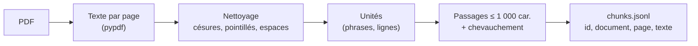

# P1-02 — Ingestion PDF en passages

## Ce qui a été fait
- `src/policy_help_desk/ingest.py` :
  - extraction du texte page par page avec `pypdf` ;
  - nettoyage : césures de fin de ligne recollées (« sanc-\ntions » → « sanctions »), lignes de pointillés des sommaires supprimées, espaces normalisés ;
  - découpage en passages d'au plus 1 000 caractères, coupés sur des fins de phrase ou de ligne, avec un chevauchement d'environ 150 caractères ;
  - un passage ne traverse jamais une page, et les fragments de moins de 40 caractères (numéros de page, en-têtes isolés) sont ignorés ;
  - chaque passage porte un identifiant stable `<document>-p<page>-c<index>`, le titre du document et le numéro de page.
- `scripts/ingest.py` écrit `data/processed/chunks.jsonl` (non versionné, régénérable) et affiche le nombre de passages par document.
- Résultat sur le corpus : 546 passages pour 9 documents (sortie de `scripts/ingest.py`).
- Tests : nettoyage, taille maximale, chevauchement, coupe des unités trop longues, conservation de la page, aller-retour JSONL.

## Pourquoi ce choix plutôt que l'alternative courante
L'alternative courante est un découpage à taille fixe (par exemple 512 tokens) sur le texte du document entier, via le découpeur d'un framework (LangChain, LlamaIndex). Deux défauts pour un assistant qui doit citer : un passage peut chevaucher deux pages (la citation devient imprécise) et une phrase peut être coupée en deux. Ici :
- découper par page donne des citations exactes (« charte des examens, p. 4 ») qu'un utilisateur peut vérifier en ouvrant le PDF ;
- couper sur les fins de phrase garde des règles lisibles ;
- le chevauchement évite qu'une règle à cheval sur deux passages soit perdue.
Le code fait 120 lignes sans framework : chaque comportement est testable et explicable. Le compromis : un article de règlement qui s'étend sur deux pages est réparti en deux passages ; la recherche devra parfois en remonter deux.

## Schéma

## 5 questions d'entretien
1. **Pourquoi des passages d'environ 1 000 caractères ?**
   Assez long pour contenir une règle complète avec son contexte (environ 150 à 250 mots), assez court pour que l'embedding reste centré sur un seul sujet et que plusieurs passages tiennent dans le prompt. C'est un point de départ : l'évaluation dira s'il faut l'ajuster.
2. **À quoi sert le chevauchement ?**
   Si une règle commence à la fin d'un passage et se termine au début du suivant, aucun des deux ne la contient en entier. En reprenant les dernières phrases au début du passage suivant, la règle reste lisible au moins une fois.
3. **Pourquoi ne jamais traverser une page ?**
   Parce que la citation est la promesse du produit : l'utilisateur doit pouvoir ouvrir la page indiquée et lire la règle. Un passage sur deux pages rend la citation ambiguë.
4. **Pourquoi `pypdf` et pas PyMuPDF ?**
   PyMuPDF est plus rapide et souvent meilleur sur les mises en page complexes, mais il est sous licence AGPL, contraignante pour un service. `pypdf` (licence BSD) extrait correctement ces documents textuels. Si un document scanné apparaît, il faudra un OCR : ce n'est pas le cas ici.
5. **Comment saurais-tu que le découpage est mauvais ?**
   Par l'évaluation, pas à l'œil : si la précision du contexte récupéré est faible alors que la réponse est bien dans le corpus, on inspecte les passages des questions ratées (règle coupée, tableau aplati, en-tête parasite) et on ajuste le découpage, puis on remesure.
