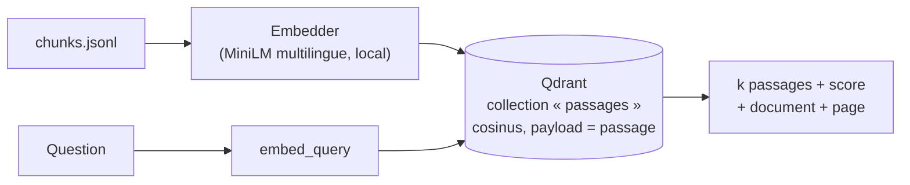

# P1-03 — Index dense et recherche (base naïve)

## Ce qui a été fait
- `embeddings.py` : interface `Embedder` (protocole Python : `dim`, `embed_documents`, `embed_query`) et implémentation `FastEmbedEmbedder` avec le modèle multilingue `sentence-transformers/paraphrase-multilingual-MiniLM-L12-v2` (384 dimensions, licence Apache-2.0), exécuté en local sur CPU via ONNX.
- `index.py` : `DenseIndex` sur Qdrant — collection recréée à chaque construction (distance cosinus), insertion par lots de 64, identifiants de points dérivés de l'identifiant du passage (UUID v5, stable), recherche des k passages les plus proches avec leurs métadonnées.
- `scripts/build_index.py` construit l'index local `data/index/qdrant` (non versionné) ; `scripts/search.py "question" k` affiche les passages trouvés avec document et page.
- Tests avec un `HashingEmbedder` déterministe et Qdrant en mémoire : pas de modèle à télécharger en CI.
- Essai manuel : « Puis-je utiliser ChatGPT pour rédiger mon mémoire ? » renvoie en premier un passage de la charte IA générative de l'UBO (p. 11). C'est une observation, pas une mesure : la mesure viendra avec le jeu d'évaluation.

## Pourquoi ce choix plutôt que l'alternative courante
- **Embeddings locaux plutôt qu'une API** (Mistral `mistral-embed`, OpenAI) : aucune clé ni coût par appel, et l'indexation est reproductible hors ligne. Le modèle choisi est multilingue (le corpus est en français) et léger (0,22 Go). Grâce à l'interface `Embedder`, passer à `mistral-embed` ou à `multilingual-e5-large` revient à écrire une classe de plus et à comparer sur le jeu d'évaluation.
- **Qdrant en mode embarqué plutôt qu'un serveur ou un index FAISS** : le même client et la même API servent en local (fichier sur disque, ou mémoire pour les tests) et en production (Qdrant Cloud, prévu au déploiement). FAISS obligerait à gérer soi-même les métadonnées et la persistance.
- **C'est volontairement la base naïve** (recherche dense seule) : elle sert de point de comparaison pour la recherche hybride et le reranking.

## Schéma

## 5 questions d'entretien
1. **Pourquoi la distance cosinus ?**
   Ce modèle d'embeddings est entraîné pour que la similarité cosinus mesure la proximité de sens ; elle ne dépend pas de la longueur des vecteurs, donc pas de la longueur du texte.
2. **Pourquoi un identifiant de point dérivé (UUID v5) plutôt qu'un compteur ?**
   Qdrant n'accepte que des entiers ou des UUID. Un UUID v5 calculé à partir de `examens-p3-c0` donne toujours le même identifiant : on peut retrouver, mettre à jour ou supprimer un passage précis sans table de correspondance.
3. **Pourquoi recréer la collection à chaque construction ?**
   Pour que l'index soit exactement le reflet du fichier de passages. Si un passage disparaît après un changement de découpage, un simple upsert le laisserait dans l'index et il pourrait être cité à tort.
4. **Quelles sont les limites de la recherche dense seule ?**
   Elle capte le sens mais rate les correspondances exactes : un numéro d'article, un sigle (« CVEC », « ENT ») ou un terme rare peut être mal classé. La recherche lexicale BM25 est forte précisément là ; d'où la recherche hybride prévue au ticket P1-07, mesurée contre cette base.
5. **Comment testes-tu un index vectoriel sans télécharger de modèle en CI ?**
   Avec un embedder factice déterministe (sac de mots haché) qui respecte la même interface, et Qdrant en mémoire. On teste ainsi notre logique (construction, recherche, métadonnées, absence de doublons), pas la qualité du modèle, qui relève de l'évaluation.
