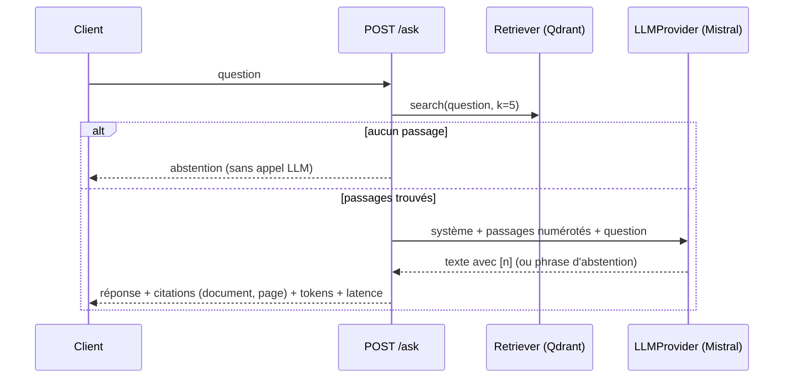

# P1-04 — Réponse avec citations

## Ce qui a été fait
- `llm.py` : interface `LLMProvider` (une méthode `complete(system, user)`) et `MistralProvider` (API chat completions, température 0, renvoie le texte et les tokens consommés pour calculer le coût).
- `rag.py` : classe `Assistant` :
  - recherche des k passages ;
  - prompt qui numérote chaque passage avec son titre et sa page ;
  - consigne de citer [n] après chaque affirmation et de répondre une phrase d'abstention exacte si les passages ne suffisent pas ;
  - extraction des citations (seulement les numéros qui existent, sans doublon) ;
  - abstention sans appel au LLM si aucun passage n'est trouvé ;
  - mesure de la latence de bout en bout.
- `api.py` : `POST /ask` (question de 3 à 500 caractères) qui renvoie la réponse, les citations (document, page), les passages récupérés et les tokens ; 503 explicite si `MISTRAL_API_KEY` manque.
- Tests : fournisseur LLM et retriever factices, appel Mistral simulé (`httpx.MockTransport`), validation de l'entrée, réponse 503 sans clé.
- **Pas encore exécuté avec le vrai modèle** : aucune clé Mistral n'est configurée. Le premier appel réel aura lieu au ticket P1-06.

## Pourquoi ce choix plutôt que l'alternative courante
L'alternative courante est d'utiliser la chaîne « RetrievalQA » d'un framework (LangChain, LlamaIndex). Elle cache le prompt, le format des citations et la logique d'abstention, précisément ce qu'il faut maîtriser et évaluer ici. Le code maison fait environ 100 lignes : chaque décision est visible et testée.
- **Abstention par phrase exacte** : plus simple à détecter qu'un champ JSON ; le compromis est qu'un modèle peut reformuler la phrase. Le jeu d'évaluation mesurera les deux erreurs : abstentions manquées et refus injustifiés.
- **Validation des citations** : un modèle peut citer [7] alors qu'il n'y a que 5 passages. On ne renvoie que des citations qui correspondent à un vrai passage ; la vérification que la citation soutient la réponse se fera dans l'évaluation.

## Schéma

## 5 questions d'entretien
1. **Pourquoi une interface `LLMProvider` plutôt qu'appeler Mistral partout ?**
   Pour changer de fournisseur ou de modèle en écrivant une seule classe, et pour tester sans réseau avec un faux fournisseur. C'est aussi ce qui permet de comparer deux modèles sur le même jeu d'évaluation.
2. **Pourquoi la température 0 ?**
   Pour des réponses aussi stables que possible : on veut qu'une même question donne la même réponse, et que l'évaluation soit reproductible. Pour un assistant documentaire, la créativité n'apporte rien.
3. **Comment l'assistant évite-t-il d'inventer ?**
   Trois garde-fous : la consigne de n'utiliser que les passages, l'obligation de citer, et une phrase d'abstention imposée. Mais une consigne ne garantit rien : c'est l'évaluation (20 questions hors corpus, vérification des citations) qui dira à quel point elle est respectée, et le seuil de pertinence du ticket P1-08 ajoutera un garde-fou indépendant du modèle.
4. **Pourquoi renvoyer les tokens consommés dans la réponse ?**
   Pour mesurer le coût réel par question (tokens × tarif) dans l'évaluation, et plus tard dans les traces Langfuse. Le coût pour 1 000 questions est une des métriques demandées.
5. **Que se passe-t-il si la clé Mistral manque en production ?**
   L'API répond 503 avec un message explicite au lieu de planter au démarrage ou de renvoyer une erreur 500 opaque ; `/health` reste disponible. En production, la clé vient de Google Secret Manager, jamais du dépôt.
