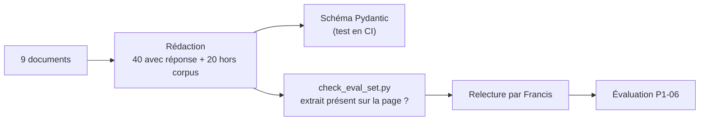

# P1-05 — Jeu d'évaluation versionné

## Ce qui a été fait
- `eval/questions.jsonl` : 60 questions rédigées à partir des 9 documents.
  - 40 questions avec réponse (`q01`–`q40`), chacune avec une réponse de référence, la ou les sources attendues (document + page) et un extrait exact (`evidence`) présent sur cette page. Couverture : ENIB / Bretagne INP (8), Université de Brest (24), IMT Atlantique / IMT (8).
  - 20 questions hors corpus (`h01`–`h20`) : plausibles pour un étudiant (CVEC, loyer CROUS, césure, gratification de stage…) mais sans réponse dans les documents ; chaque thème a été cherché dans le texte extrait avant d'être retenu, et un thème partiellement traité (stationnement) a été écarté.
- `src/studeria_assistant/evalset.py` : schéma Pydantic (une question avec réponse exige réponse, source et extrait ; une question hors corpus n'a ni réponse ni source) et contrôle de cohérence (40 + 20, identifiants uniques, sources connues).
- `scripts/check_eval_set.py` : vérifie sur les PDF que chaque extrait figure sur la page attendue — 40/40 le 11/10/2026.
- `eval/A-VALIDER.md` : procédure de relecture. **Le jeu est marqué « à valider par Francis ».**

## Pourquoi ce choix plutôt que l'alternative courante
L'alternative courante est de générer automatiquement des questions avec un LLM (par exemple avec Ragas) à partir des passages. C'est rapide, mais les questions générées ressemblent trop au texte des passages : elles favorisent la recherche dense et surestiment la qualité. Elles ne contiennent pas non plus de vraies questions hors corpus. Ici, les questions sont formulées comme un utilisateur (« Puis-je venir avec mon chien ? » plutôt que « Quelles sont les règles relatives aux animaux ? »), et chaque référence est vérifiable mécaniquement grâce à l'extrait.
Compromis : 60 questions donnent des mesures **exploratoires** (un écart de quelques points entre deux versions n'est pas significatif). On le dira explicitement dans `docs/evaluation.md`.

## Schéma

## 5 questions d'entretien
1. **Pourquoi 20 questions hors corpus ?**
   Pour mesurer ce qui compte le plus pour un assistant interne : sa capacité à dire « je ne sais pas ». Sans elles, un assistant qui répond toujours quelque chose aurait de bons scores.
2. **Pourquoi ne pas faire générer les questions par un LLM ?**
   Les questions générées reprennent le vocabulaire des passages, ce qui facilite artificiellement la recherche, et le LLM qui les génère partage les biais de celui qu'on évalue. Écrire les questions à la main, comme un utilisateur, donne une mesure plus honnête. Un LLM pourra servir plus tard à augmenter le jeu, avec relecture.
3. **À quoi sert le champ `evidence` ?**
   À rendre chaque référence vérifiable par un script : si un établissement remplace son PDF ou si le découpage change les numéros de page, le contrôle échoue et on sait quelles questions revoir.
4. **Que mesure-t-on avec les questions qui ont une réponse ?**
   L'exactitude de la réponse, la présence de la source attendue parmi les passages récupérés et cités, et le taux de refus injustifiés (l'assistant s'abstient alors que la réponse est dans les documents).
5. **Pourquoi présenter les résultats comme exploratoires ?**
   Avec 40 questions, une question vaut 2,5 points de pourcentage : l'incertitude est grande. On peut détecter de gros écarts (base naïve vs version finale), pas des différences fines. La suite serait d'élargir le jeu, avec des questions réelles d'utilisateurs.
