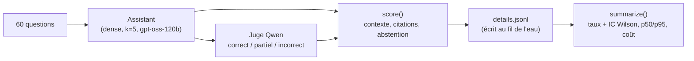

# P1-06 — Mesure des erreurs de la base naïve

## Ce qui a été fait
- **Changement de fournisseur LLM.** L'offre gratuite de Mistral ne donne plus accès à l'API. `llm.py` expose donc une classe générique `ChatCompletionsProvider` (format chat completions, commun à Groq, Mistral, Ollama…) :
  - par défaut, Groq (offre gratuite) avec `openai/gpt-oss-120b` ;
  - nouvelles tentatives sur les refus de débit (429), les erreurs 5xx et les coupures réseau, avec un temps d'attente exclu de la latence mesurée.
- `evaluation.py` (pur, testé) :
  - notation de chaque question (verdict du juge, page et document attendus dans le contexte, citation correcte) ;
  - intervalles de Wilson ;
  - percentiles de latence ;
  - coût pour 1 000 questions.
- `scripts/run_eval.py` :
  - écrit chaque résultat au fil de l'eau et reprend là où il s'est arrêté (une coupure réseau a interrompu le premier essai à la question 34) ;
  - espace les appels pour respecter la limite de 8 000 tokens par minute.
- Résultats de la base naïve dans `eval/results/baseline-dense.json` et analyse dans `docs/evaluation.md` :
  - exactitude 42,5 % (17/40, IC 95 % : 29–58 %) ;
  - refus injustifiés 37,5 % (15/40) ;
  - abstention correcte 100 % (20/20) ;
  - latence p50 de 1,0 s et p95 de 2,0 s ;
  - 0,31 $ pour 1 000 questions au tarif public.
- Diagnostic : 12 des 15 refus viennent d'une page attendue absente des 5 passages récupérés, alors que le bon document est presque toujours trouvé.

## Pourquoi ce choix plutôt que l'alternative courante
- **Juge d'une autre famille de modèles** (Qwen pour juger GPT-OSS) plutôt que le même modèle : un modèle a tendance à valider ses propres formulations.
- **Abstention comptée comme une erreur** sur les questions qui ont une réponse : sinon un assistant qui refuse tout aurait 100 % de précision sur ce qu'il dit.
- **Intervalles de confiance** plutôt qu'un chiffre seul : avec 40 questions, 42,5 % veut dire « entre 29 et 58 % ». C'est ce qui évite d'annoncer un progrès qui n'est que du bruit.
- **Métrique de contexte à deux niveaux** (document / page) : c'est elle qui a localisé le problème (97,5 % vs 62,5 %). Sans elle, on aurait pu passer du temps à retoucher le prompt alors que c'est la recherche qui échoue.

## Schéma

## 5 questions d'entretien
1. **Ton assistant n'a que 42,5 % d'exactitude : est-ce mauvais ?**
   C'est la base naïve, mesurée pour servir de point de comparaison. Le chiffre important est ailleurs : 0 réponse inventée sur 20 questions hors corpus, et un diagnostic clair. Les erreurs viennent surtout de la recherche (la bonne page manque dans 12 refus sur 15), ce qui oriente l'amélioration vers la recherche hybride et le reranking.
2. **Pourquoi utiliser un LLM comme juge, et quelles en sont les limites ?**
   Comparer une réponse libre à une référence demande de comprendre le sens ; une métrique de chevauchement de mots (BLEU, ROUGE) pénalise les reformulations justes. Les limites : le juge peut être sévère ou indulgent, d'où un modèle d'une autre famille, une sortie JSON stricte (toute sortie illisible compte comme incorrecte) et une relecture humaine d'un échantillon de verdicts.
3. **Comment calcules-tu un intervalle de Wilson, et pourquoi pas l'intervalle « ± 1,96 × écart-type » ?**
   L'intervalle normal classique devient faux près de 0 % ou 100 % et sur de petits échantillons (il peut sortir de [0, 1] ou avoir une largeur nulle à 20/20). Wilson corrige cela : à 20/20 il donne encore 84–100 %, ce qui rappelle honnêtement qu'on n'a testé que 20 cas.
4. **Pourquoi exclure les attentes de quota de la latence ?**
   La latence doit décrire le système, pas l'offre gratuite utilisée pour le tester. Le temps passé à attendre après un refus de débit, ou après une coupure réseau, est mesuré à part et soustrait.
5. **Qu'as-tu appris de la coupure réseau pendant l'évaluation ?**
   Qu'un traitement long qui n'écrit qu'à la fin perd tout au premier incident. Le script écrit maintenant chaque résultat dès qu'il est obtenu et reprend où il s'était arrêté, et le client réessaie sur les erreurs passagères. C'est la même logique qu'un job de traitement par lots en production.
