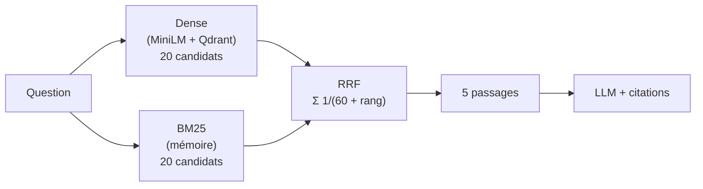

# P1-07 — Recherche hybride dense + BM25

## Ce qui a été fait
- `bm25.py` : BM25 écrit à la main (k1 = 1,5, b = 0,75), sans dépendance.
  - Tokenisation française : minuscules, accents retirés, mots-outils retirés, chiffres conservés.
  - Index en mémoire sur les 546 passages, environ 1,4 ms par requête.
- `hybrid.py` : fusion par **Reciprocal Rank Fusion**. On prend 20 candidats à la recherche dense et 20 à BM25. Le score de chaque passage vaut la somme de 1 / (60 + rang) sur les deux classements, et on garde les 5 meilleurs.
- `scripts/eval_retrieval.py` : comparaison gratuite de la recherche seule (dense, BM25, hybride) à k = 1, 3, 5 et 10, sans appeler de LLM.
- `scripts/run_eval.py --retrieval hybride` : évaluation complète avec le même modèle, le même juge et les mêmes 60 questions que la base naïve.
- L'API utilise désormais l'hybride par défaut (paramètre `RETRIEVAL`, valeur `dense` possible).
- Résultats :
  - page attendue récupérée : 62,5 % → 80 % ;
  - refus injustifiés : 37,5 % → 22,5 % ;
  - correct ou partiel : 57,5 % → 70 % ;
  - abstention hors corpus : toujours 20/20 ;
  - réponses incorrectes : 2 → 3.

## Pourquoi ce choix plutôt que l'alternative courante
- **RRF plutôt qu'une moyenne pondérée des scores.** Un score cosinus (entre −1 et 1) et un score BM25 (sans borne) ne sont pas comparables : il faudrait les normaliser et choisir un poids, donc régler un paramètre sur le jeu de test. RRF ne combine que des rangs, avec une constante standard (60), sans réglage.
- **BM25 maison plutôt qu'une bibliothèque** (`rank-bm25`) ou les vecteurs creux de Qdrant. Environ 60 lignes, explicables ligne à ligne, testées, sans dépendance. Le corpus tient en mémoire. Si le corpus grossit, Qdrant sait stocker des vecteurs creux et faire la fusion côté serveur : c'est la piste pour passer à l'échelle.
- **Pas de réglage sur le jeu de test.** BM25 seul fait aussi bien que l'hybride sur ce jeu. Choisir « BM25 seul » parce qu'il gagne de deux questions serait du surajustement. L'hybride était le choix annoncé avant la mesure, et il reste robuste aux reformulations.

## Schéma

## 5 questions d'entretien
1. **Pourquoi BM25 aide-t-il un assistant documentaire ?**
   Les règlements sont pleins de détails exacts : « 15 minutes », « 5 jours ouvrés », « eduroam ». Un embedding capte le sens général d'un passage mais dilue ces détails. BM25 récompense précisément les termes rares partagés entre la question et le passage. Sur notre jeu, la bonne page est retrouvée dans 80 % des cas avec BM25, contre 62,5 % en dense.
2. **Comment fonctionne BM25, en une phrase par terme ?**
   L'IDF donne plus de poids à un mot rare dans le corpus. La fréquence du mot dans le passage compte, mais sature grâce à k1 : dix fois le mot ne vaut pas dix fois plus. La longueur du passage est normalisée par b, pour qu'un long passage ne gagne pas juste parce qu'il contient plus de mots.
3. **Pourquoi fusionner des rangs et pas des scores ?**
   Parce que les échelles sont incomparables. Un 0,45 en cosinus et un 12 en BM25 ne veulent rien dire ensemble. Les rangs, eux, le sont toujours. RRF favorise un passage bien classé par les deux méthodes, sans paramètre à régler.
4. **L'exactitude passe de 42,5 % à 47,5 % : est-ce une vraie amélioration ?**
   Pas démontrée : les intervalles de confiance se recouvrent. Ce qui est net, c'est la récupération de la bonne page (+7 questions) et la baisse des refus (15 → 9). Je le présente comme ça, sans gonfler le résultat.
5. **Quel risque l'amélioration a-t-elle introduit ?**
   En répondant plus souvent, l'assistant se trompe un peu plus (3 réponses incorrectes au lieu de 2). L'une est grave : q19 dit qu'on peut stocker des données de l'UBO sur un ordinateur personnel, alors que la charte l'interdit et que la page était dans le contexte. Il faut donc mesurer les erreurs à chaque amélioration, pas seulement le taux de bonnes réponses. Le ticket suivant (reranking et seuil d'abstention) devra faire baisser les refus sans faire monter ce chiffre.
