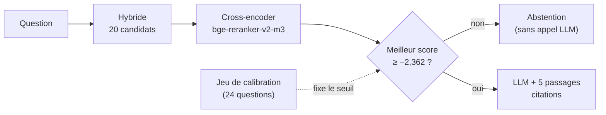

# P1-08 — Reranking et seuil d'abstention

## Ce qui a été fait
- `rerank.py` : `RerankingRetriever`. Il prend N candidats à la recherche hybride, les fait relire par un cross-encoder (`BAAI/bge-reranker-v2-m3-int8`, multilingue, Apache-2.0, local) et garde les 5 meilleurs. Une option permet de ne montrer au reranker que le début des passages ; le LLM reçoit toujours le passage complet.
- `Assistant(min_score=…)` : si le meilleur score du reranker est sous le seuil, l'assistant s'abstient **sans appeler le LLM** (champ `abstained_before_llm`).
- `eval/calibration.jsonl` : 24 questions nouvelles (12 avec réponse, extraits vérifiés sur les PDF ; 12 hors corpus), distinctes du jeu de test.
- `scripts/calibrate_threshold.py` et `scripts/choose_rerank_setting.py` : seuil et réglage choisis **uniquement** sur la calibration, avec des règles écrites avant la mesure.
- Résultats sur le jeu de test, réglage complet (20 candidats) avec seuil −2,362 :
  - exactitude 70 % (contre 42,5 % pour la base naïve) ;
  - correct ou partiel 95 % ;
  - refus injustifiés 5 % ;
  - aucune réponse incorrecte ;
  - abstention hors corpus 20/20, dont 15 sans appel au LLM ;
  - **latence de 10,5 s sur CPU**.
- Le réglage rapide (10 candidats, 400 caractères, 2,6 s), choisi par la règle de budget, n'apporte presque rien : tronquer les passages fait perdre au reranker ce qui le rend utile.
- L'API utilise le réglage complet par défaut. La latence est le sujet du déploiement.

## Pourquoi ce choix plutôt que l'alternative courante
- **Cross-encoder plutôt que LLM reranker.** Faire classer les passages par le LLM coûte un appel de plus par question et consomme le quota. Le cross-encoder est un petit modèle local, déterministe et gratuit, entraîné précisément pour cette tâche.
- **Seuil calibré sur un jeu distinct plutôt que réglé sur le jeu de test.** Choisir le seuil qui donne le meilleur score sur le jeu de test revient à apprendre les réponses de l'examen. Ici, le seuil vient de 24 autres questions, et il a bien fonctionné sur le jeu de test (15/20 questions hors corpus bloquées, une seule question avec réponse bloquée, dont la page n'était de toute façon pas trouvée).
- **Un garde-fou indépendant du modèle.** L'abstention du LLM dépend d'une consigne qu'il peut ignorer. Le seuil est une règle déterministe en amont : il protège même si on change de modèle, et il économise des appels.
- **Honnêteté sur la décision finale.** La règle de budget avait retenu le réglage rapide. Le passage au réglage complet a été décidé après avoir vu le jeu de test : c'est écrit dans `docs/evaluation.md`.

## Schéma

## 5 questions d'entretien
1. **Quelle différence entre un bi-encoder (embeddings) et un cross-encoder ?**
   Le bi-encoder encode la question et le passage séparément puis compare deux vecteurs : rapide, car les passages sont encodés une fois pour toutes, mais approximatif. Le cross-encoder lit la question et le passage ensemble, avec une attention entre les deux : beaucoup plus précis, mais il faut le recalculer pour chaque paire. D'où l'architecture en deux étages : la recherche large, puis le reranking sur 20 candidats.
2. **Pourquoi calibrer le seuil sur un jeu séparé ?**
   Si je règle le seuil sur le jeu de test, le score obtenu ne mesure plus la performance réelle : il mesure ma capacité à m'ajuster à ces 60 questions. Le jeu de calibration joue le rôle d'un jeu de validation. La règle était décidée avant : aucun refus sur les questions de calibration qui ont une réponse.
3. **Le réglage rapide n'apporte rien : comment l'expliques-tu ?**
   En tronquant à 400 caractères, le reranker ne voit souvent pas la phrase qui contient la réponse (les passages font jusqu'à 1 000 caractères). Il reclasse alors sur un début de passage peu informatif. La leçon : on n'accélère pas un modèle en lui retirant l'information dont il a besoin. Il faut une machine plus rapide, un modèle plus petit ou des passages plus courts dès l'ingestion.
4. **10 secondes de latence : est-ce acceptable ?**
   Pour une démo publique, non. Pour un assistant interne où une réponse fausse coûte cher, c'est un compromis défendable, mais on doit le réduire. Pistes à mesurer : GPU (un cross-encoder de cette taille passe sous la seconde), un reranker plus petit, des passages plus courts, ou un service de reranking. La décision se prendra au déploiement, chiffres à l'appui.
5. **Pourquoi le coût par question baisse-t-il alors qu'on ajoute un modèle ?**
   Le reranker tourne en local, sans coût d'API. Et le seuil bloque 15 questions hors corpus sur 20 avant le LLM : ces questions ne consomment plus de tokens. Le coût moyen pour 1 000 questions passe de 0,31 $ à 0,25 $ au tarif public.
