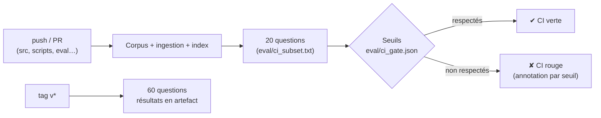

# P1-09 — Évaluation en CI

## Ce qui a été fait
- `eval/ci_subset.txt` : 20 questions choisies par une règle déterministe, une sur trois. Cela donne 14 questions avec réponse (q01, q04, …, q40) et 6 hors corpus (h01, h04, …, h16), réparties sur tous les documents.
- `eval/ci_gate.json` : seuils bloquants fixés **avant** la première exécution en CI, en nombre de questions :
  - correct ou partiel : au moins 11/14 ;
  - abstention correcte : 6/6 ;
  - réponses incorrectes : au plus 1 ;
  - refus injustifiés : au plus 3.

  La configuration retenue fait 13/14, 6/6, 0 et 1 sur ce sous-ensemble. La base naïve (8/14) et l'hybride seul (7/14, 2 incorrectes) auraient été bloqués : les seuils détectent bien une régression.
- `check_gate()` dans `evaluation.py` (fonction pure, testée) et `scripts/check_gate.py`, qui renvoie le code 1 et affiche une annotation d'erreur GitHub pour chaque seuil non atteint.
- `scripts/run_eval.py --subset` : n'évalue que les identifiants listés.
- `.github/workflows/eval.yml` :
  - à chaque push ou PR qui touche le code, les scripts, le jeu ou les sources : téléchargement du corpus, vérification des extraits, ingestion, index, évaluation des 20 questions, puis contrôle des seuils ;
  - à chaque tag `v*` : évaluation complète des 60 questions ;
  - résultats publiés en artefact ;
  - modèles locaux mis en cache ;
  - une seule évaluation à la fois, à cause des limites de débit de l'offre gratuite ;
  - si le secret `LLM_API_KEY` manque (par exemple sur un fork), le job s'arrête avec un avertissement au lieu d'échouer.

## Pourquoi ce choix plutôt que l'alternative courante
- **Évaluer en CI plutôt qu'à la main de temps en temps.** Un changement de prompt, de découpage ou de dépendance peut dégrader l'assistant sans casser aucun test unitaire. Les tests vérifient que le code fait ce qu'on a écrit ; l'évaluation vérifie que le système répond toujours juste. C'est l'équivalent, pour un système d'IA, des tests de non-régression.
- **20 questions et non 60 à chaque push.** Le coût (quota de tokens) et la durée restent raisonnables. L'évaluation complète, plus fiable, est réservée aux versions taguées.
- **Seuils en nombre de questions, avec marge.** Le LLM et le juge ne sont pas parfaitement déterministes même à température 0 : un seuil réglé exactement sur le score actuel ferait échouer la CI au hasard. La marge (11/14 au lieu de 13/14) absorbe ce bruit, tout en bloquant les régressions réelles mesurées (8/14 et 7/14).
- **Abstention à 6/6 sans marge.** Répondre à une question hors corpus, c'est inventer. C'est l'erreur qu'on refuse de laisser passer.

## Schéma

## 5 questions d'entretien
1. **Quelle différence entre un test unitaire et une évaluation en CI ?**
   Le test unitaire vérifie une fonction sur un cas connu, de façon déterministe : « les citations sont dédoublonnées ». L'évaluation vérifie le comportement du système complet sur des questions réelles, avec un LLM : « l'assistant répond juste et s'abstient quand il faut ». Les deux sont nécessaires.
2. **Comment évites-tu que la CI échoue au hasard à cause du LLM ?**
   Température 0, un juge fixe, et des seuils avec une marge mesurée : la configuration actuelle fait 13/14, le seuil est à 11/14. Si un échec arrive quand même, on relance et on regarde les détails publiés en artefact, question par question, avant de conclure.
3. **Pourquoi ne pas évaluer les 60 questions à chaque push ?**
   À cause du coût et du quota : un push déclenche environ 30 000 tokens, avec une limite gratuite de 200 000 par jour. Et de la durée : le reranker sur CPU prend environ 10 s par question. Le sous-ensemble détecte les grosses régressions ; l'évaluation complète sur tag donne les chiffres publiables.
4. **Que se passe-t-il si quelqu'un ouvre une PR depuis un fork ?**
   Les secrets ne sont pas transmis aux workflows des forks. Le job détecte l'absence de clé et s'arrête avec un avertissement, au lieu d'échouer ou d'exposer quoi que ce soit.
5. **Comment le sous-ensemble a-t-il été choisi, et quel est son risque ?**
   Par une règle fixe (une question sur trois), écrite avant de voir les résultats, pour ne pas choisir les questions faciles. Le risque est la représentativité : 20 questions peuvent manquer une régression sur un document peu couvert. C'est pourquoi l'évaluation complète tourne à chaque version.

## Essai local avant le premier push (13/10/2026)
`run_eval.py ci-local --subset eval/ci_subset.txt` avec la configuration par défaut :
- correct ou partiel 12/14 ;
- abstention correcte 6/6 ;
- 1 réponse incorrecte ;
- 1 refus injustifié.

Les seuils sont respectés (code de sortie 0). Cet essai illustre la variabilité : q22 est jugée « incorrecte » ici et « partielle » dans l'évaluation complète. C'est aussi la question dont la référence semble incomplète (le guide prévoit 3 semaines en règle générale et 15 jours en cas de force majeure). Elle consomme à elle seule la marge du seuil « réponses incorrectes ≤ 1 ». Compléter sa référence est la prochaine correction à faire sur le jeu.
