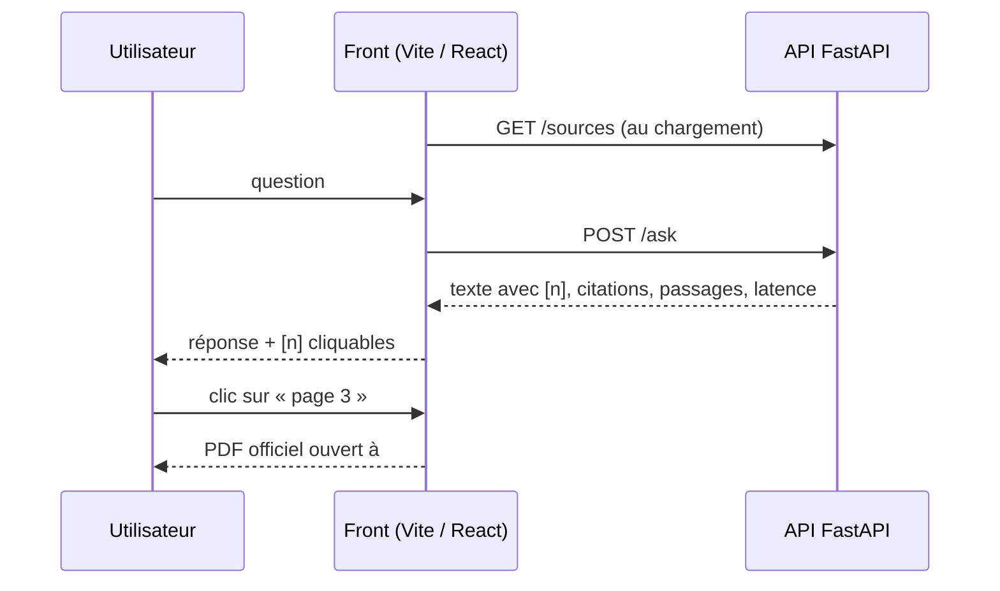

# P1-10 — Interface de chat

## Ce qui a été fait
- **API**
  - `GET /sources` renvoie les 9 documents avec leur URL officielle.
  - CORS est configurable par `ALLOWED_ORIGINS`, avec `http://localhost:5173` par défaut.
- **Front** `frontend/` (React 19 + Vite + TypeScript) :
  - question libre ou questions d'exemple ;
  - réponse avec les renvois [n] rendus en boutons qui font défiler jusqu'à la source ;
  - pour chaque source : titre du document, page, passage utilisé (dépliable) et lien **« Ouvrir le document officiel à la page N »**, qui ouvre le PDF de l'établissement au fragment `#page=N` ;
  - abstention présentée à part (encadré distinct, sans source, avec un renvoi vers le service concerné) ;
  - latence affichée ;
  - liste des documents consultés et rappel de vérifier la source ;
  - thème clair et sombre, mise en page mobile sans débordement (vérifiée à 375 px).
- `format.ts` : fonctions pures pour découper la réponse (texte, gras, renvois), construire le lien vers la page du PDF et formater la latence.
- **Tests**
  - Vitest sur `format.ts`.
  - Test d'intégration de `App` avec une fausse API : parcours question → réponse → lien `…pdf#page=3`, et cas de l'abstention.
- **CI** : nouveau job `front` (types, lint, tests, build).
- **Vérification de bout en bout en local** : « Combien de temps avant un examen faut-il arriver à l'UBO ? » donne « au minimum 15 minutes avant le début de l'épreuve », avec la charte des examens, page 3, et le lien vers le PDF officiel. Réponse en 11,1 s, avec le reranker sur CPU.

## Pourquoi ce choix plutôt que l'alternative courante
- **Lier au PDF officiel plutôt que l'héberger.** L'utilisateur vérifie la règle chez l'établissement lui-même, et on ne redistribue pas les documents. Le fragment `#page=N` est compris par les lecteurs PDF des navigateurs.
- **Citations cliquables plutôt qu'une liste de sources en bas de page.** La promesse du produit, c'est « vous pouvez vérifier ». Chaque affirmation mène à son passage et à sa page en un clic.
- **Pas de bibliothèque d'interface** (Material UI, Tailwind…). Une page, quelques composants, environ 200 lignes de CSS : moins de dépendances à maintenir et un bundle de 72 ko compressé.
- **Abstention mise en forme comme un résultat.** « Je ne trouve pas » n'est pas une erreur, c'est le comportement attendu. L'interface le montre sans alarmer et oriente vers le bon interlocuteur.

## Schéma

## 5 questions d'entretien
1. **Comment le front sait-il quel PDF ouvrir pour une citation ?**
   La citation contient l'identifiant du document et la page. Au chargement, le front récupère `/sources`, qui associe chaque identifiant à son URL officielle, puis construit `url#page=N`. L'API ne duplique pas l'URL dans chaque réponse.
2. **Pourquoi a-t-il fallu configurer CORS ?**
   Le front (port 5173 en local, Vercel en production) et l'API (port 8000, Cloud Run) n'ont pas la même origine. Le navigateur bloque la requête si l'API ne déclare pas l'origine autorisée. On liste explicitement les origines plutôt que `*`, pour que l'API ne soit pas appelable depuis n'importe quel site.
3. **Comment testes-tu un composant qui appelle une API ?**
   On remplace `fetch` par une fausse fonction qui renvoie une réponse fixe. Puis on simule l'utilisateur avec Testing Library (taper, cliquer) et on vérifie ce qu'il voit : le texte, le bouton de citation, le lien avec le bon `href`. On teste le comportement visible, pas l'implémentation.
4. **Un test échouait parce que le rendu du test précédent restait dans la page : pourquoi ?**
   Testing Library démonte les composants après chaque test seulement si Vitest expose ses fonctions globales. Sans elles, il faut appeler `cleanup()` dans un `afterEach`. C'est une erreur de configuration de test, pas de l'application.
5. **Que manque-t-il avant une démo publique ?**
   La latence (environ 10 s avec le reranker sur CPU) et la protection contre les abus : limite par IP et quota quotidien, prévus au ticket suivant avec les traces Langfuse. Puis le déploiement (Cloud Run et Vercel), où le front pointera vers l'URL publique de l'API.
