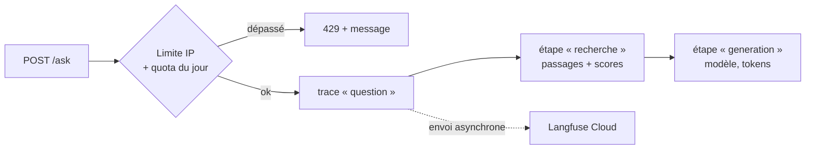

# P1-11 — Traces Langfuse et protection de la démo

## Ce qui a été fait
- `tracing.py` : interface `Tracer` (une méthode `observe(nom, type, …)` qui ouvre une étape de trace) avec deux implémentations :
  - `NoopTracer` par défaut : ne fait rien ;
  - `LangfuseTracer` : envoie à Langfuse Cloud via le SDK v4 basé sur OpenTelemetry.
- `Assistant` ouvre une trace par question :
  - `question` (type *chain*) : la question en entrée, la réponse en sortie, et en métadonnées l'abstention (oui/non, avant ou après le LLM), les citations et la latence ;
  - `recherche` (type *retriever*) : les passages retenus et leurs scores ;
  - `generation` (type *generation*) : le prompt, la réponse, le modèle et les tokens d'entrée et de sortie. Cette étape n'existe pas quand le seuil fait s'abstenir l'assistant avant le LLM.
- L'API n'active Langfuse que si `LANGFUSE_PUBLIC_KEY` et `LANGFUSE_SECRET_KEY` sont configurées.
- `ratelimit.py` : `DemoLimiter` applique deux limites, toutes deux configurables :
  - **10 questions par adresse IP sur 10 minutes** (fenêtre glissante) ;
  - **300 questions par jour au total**, remis à zéro à minuit UTC.

  Au-delà, `POST /ask` répond 429 avec un message clair, que l'interface affiche. Une demande refusée ne consomme pas le quota. L'adresse est la dernière valeur de `X-Forwarded-For`, celle ajoutée par le proxy de Cloud Run.
- Tests : faux traceur qui enregistre les étapes et les tokens, horloge injectable pour la fenêtre glissante et le changement de jour, test de l'API qui renvoie 429.
- **Vérifié en réel le 13/10/2026** : une question posée à l'API a produit dans Langfuse une trace `question` avec ses étapes `recherche` (10,5 s) et `generation` (1,2 s, `openai/gpt-oss-120b`, 1 203 tokens en entrée et 380 en sortie). La trace montre que **la latence vient du reranker**, pas du LLM : c'est l'information qui orientera le déploiement.

## Pourquoi ce choix plutôt que l'alternative courante
- **Une interface `Tracer` plutôt que des décorateurs Langfuse partout.** Le code métier ne dépend pas du fournisseur de traces : on peut tester sans réseau, désactiver les traces sans clés, ou passer à un autre outil OpenTelemetry en écrivant une seule classe.
- **Des traces par étape plutôt qu'un simple log de la réponse.** Savoir qu'une question a pris 11,6 s ne dit pas quoi optimiser ; savoir que 10,5 s viennent de la recherche, si.
- **Une limite en mémoire plutôt que Redis.** La démo tourne sur une seule instance : des compteurs en mémoire sont exacts, gratuits et sans dépendance. Le compromis est écrit dans le code : avec plusieurs instances, il faudrait un stockage partagé.
- **La dernière valeur de `X-Forwarded-For`, pas la première.** Le client peut écrire ce qu'il veut au début de l'en-tête pour contourner la limite. Seule la valeur ajoutée par le proxy de confiance est fiable.

## Schéma

## 5 questions d'entretien
1. **À quoi sert une trace par rapport à un log ?**
   Un log est une ligne isolée. Une trace relie toutes les étapes d'une même requête, avec leur durée et leurs entrées/sorties : on voit d'un coup d'œil que la recherche prend 10,5 s et la génération 1,2 s, ou quels passages ont été donnés au modèle quand il a répondu faux.
2. **Comment les traces n'ajoutent-elles pas de latence ?**
   Le SDK met les étapes en file et les envoie en arrière-plan, par lots. La requête de l'utilisateur n'attend pas le serveur Langfuse. Le coût est une petite consommation mémoire et réseau en tâche de fond.
3. **Pourquoi limiter par IP et aussi par jour ?**
   La limite par IP empêche un seul visiteur de monopoliser la démo. Le quota du jour protège le budget global : même avec beaucoup de visiteurs différents, on ne dépasse pas le quota gratuit du fournisseur LLM. Les deux protègent contre des risques différents.
4. **Quelles sont les limites de cette protection ?**
   Les compteurs sont en mémoire : ils repartent de zéro au redémarrage et ne sont pas partagés entre instances. Une personne qui change d'adresse IP contourne la limite par IP, mais pas le quota global. Pour une démo de portfolio, c'est proportionné ; pour un vrai service, on ajouterait un stockage partagé et une authentification.
5. **Que ne trace-t-on pas encore ?**
   Le coût : Langfuse ne connaît pas le tarif de Groq pour `gpt-oss-120b`. On peut le passer explicitement (`cost_details`) à partir du tarif public relevé dans l'évaluation. On ne relie pas non plus encore les traces aux résultats d'évaluation (scores Langfuse) : ce serait la suite pour suivre la qualité en production.
