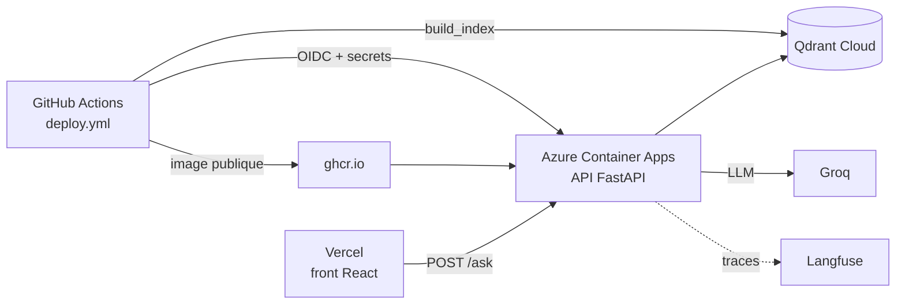

# P1-12 — Déploiement

## Ce qui a été fait
- **Index dense sur Qdrant Cloud** : `make_qdrant_client()` utilise le cluster dès que `QDRANT_URL` est défini, et l'index local sinon.
- **Image de l'API** (`Dockerfile`), publiée par GitHub Actions sur le registre GitHub (`ghcr.io/itxmveng/policy-binder`). L'image est publique et ne contient **aucun texte des règlements** : le conteneur télécharge les 9 PDF officiels et les découpe à son démarrage (`deploy/start.sh`). Les modèles locaux (embeddings, reranker) sont préchargés au build.
- **Infrastructure Azure** en Terraform (`infra/azure`) :
  - groupe de ressources en France Centre ;
  - environnement Container Apps, sans espace de journaux payant ;
  - application `policy-binder-api` avec 2 vCPU et 4 Go, une instance au plus, mise à zéro sans trafic ;
  - identité de déploiement GitHub par **connexion fédérée OIDC**, limitée à la branche `main` et aux droits du groupe de ressources.
- **Workflow `deploy.yml`** en trois jobs :
  1. index Qdrant Cloud ;
  2. image ;
  3. connexion Azure sans mot de passe stocké, puis injection des secrets depuis les secrets GitHub, nouvelle image et vérification de `/health`.
- **Front** publié sur Vercel : https://policy-binder.vercel.app, construit avec l'adresse de l'API.
- **Terraform Cloud Run** (`infra/terraform`) conservé et validé en CI : prêt pour le jour où un compte de facturation Google Cloud sera disponible.
- **Latence mesurée sur l'API publique** (6 questions du jeu de test, 16/10/2026) : médiane **8,2 s**, maximum 8,6 s. Après une mise à zéro, la première question prend environ 12,5 s, le temps de charger les modèles. C'est sous le seuil fixé (15 s) : **le reranker est gardé**.

## Écarts avec le plan initial, et pourquoi
- **Azure Container Apps au lieu de Cloud Run.** Cloud Run exige un compte de facturation, même pour l'offre gratuite. Les crédits Google Skills ne valent que pour des labs temporaires. Hugging Face Spaces exige désormais un abonnement payant pour les Spaces Docker : le premier déploiement a été refusé avec une erreur 402. Azure for Students fournit des crédits sans carte bancaire.
- **Problèmes rencontrés et corrigés** :
  - l'abonnement n'était pas autorisé à utiliser `Microsoft.App` ;
  - GitHub présente désormais un sujet OIDC avec des identifiants immuables (`repo:ItxMveng@120726751/policy-binder@1414717471:…`) ;
  - PowerShell retirait les guillemets d'une liste JSON d'origines CORS, d'où le passage à une liste séparée par des virgules.

## Pourquoi ce choix plutôt que l'alternative courante
- **OIDC plutôt qu'une clé de service stockée dans GitHub.** Aucun mot de passe à faire tourner ni à fuiter. Azure ne fait confiance qu'aux jetons émis par GitHub pour ce dépôt précis et cette branche, et chaque jeton expire en quelques minutes.
- **Secrets hors Terraform.** Les valeurs passent des secrets GitHub à l'application par `az containerapp secret set`. Elles ne finissent jamais dans l'état Terraform, qui reste un fichier local.
- **Corpus téléchargé au démarrage plutôt que dans l'image.** L'image peut être publique sans redistribuer les documents des établissements. Le prix : quelques secondes de plus au démarrage, et une dépendance aux sites officiels.

## Schéma

## 5 questions d'entretien
1. **Comment GitHub Actions se connecte-t-il à Azure sans mot de passe ?**
   Par une identité fédérée (OIDC). GitHub émet un jeton signé qui décrit le dépôt et la branche. Azure vérifie la signature et compare le « sujet » à celui qui est déclaré. S'ils correspondent, Azure délivre un accès temporaire limité au groupe de ressources. Aucun secret n'est stocké.
2. **Pourquoi l'API ne tourne-t-elle que sur une instance ?**
   Les limites de la démo (questions par IP et par jour) sont tenues en mémoire. Avec plusieurs instances, chacune aurait ses propres compteurs. Pour monter en charge, il faudrait un stockage partagé, comme Redis.
3. **D'où viennent les 8 secondes de latence, et comment les réduire ?**
   Les traces Langfuse le montrent : du reranker sur CPU, qui relit 20 passages. Pistes : un GPU, un reranker plus petit, des passages plus courts dès l'ingestion, ou moins de candidats. Chaque piste doit être mesurée sur le jeu d'évaluation, car le réglage rapide testé en P1-08 faisait perdre le gain de qualité.
4. **Pourquoi avoir gardé le Terraform Cloud Run alors qu'il n'est pas utilisé ?**
   Il correspond à la cible initiale et reste validé en CI à chaque push. Le jour où un compte de facturation existe, on applique ce Terraform avec la même image. C'est aussi une preuve que l'infrastructure n'est pas liée à un seul fournisseur.
5. **Qu'est-ce qui pourrait casser cette démo, et comment le saurais-tu ?**
   Un site officiel indisponible au démarrage (le conteneur ne démarre pas), un quota Groq épuisé (erreurs 429) ou des crédits Azure consommés. Le workflow vérifie `/health` après chaque déploiement et Langfuse montre les erreurs. Une sonde périodique sur `/health` avec alerte serait la suite.
