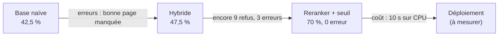

# P1-13 — Rapport d'évaluation

## Ce qui a été fait
`docs/evaluation.md` est le rapport complet, lisible par un recruteur technique en quelques minutes. Il contient :
- une **synthèse** de trois chiffres clés et du compromis : exactitude 70 % contre 42,5 %, refus injustifiés 5 % avec 0 réponse incorrecte, abstention 20/20, au prix de 10,5 s de latence sur CPU ;
- **les jeux de questions** : le jeu de test (60 questions, réparties par établissement), le jeu de calibration distinct (24 questions) et le sous-ensemble CI (20 questions), avec leurs règles de constitution ;
- **le protocole** : modèle, juge d'une autre famille, définition exacte de chaque métrique, calcul du coût ;
- **les résultats** des trois configurations (dense, hybride, hybride + reranker + seuil) avec les intervalles de confiance, plus la comparaison de la recherche seule à k = 1, 3, 5 et 10 ;
- **l'analyse des erreurs** à chaque étape et ce qui a motivé l'étape suivante ;
- **l'évaluation en continu** : sous-ensemble CI, seuils, premier passage réel ;
- **les commandes** pour tout reproduire ;
- **les limites**, dont la décision prise après avoir vu le jeu de test et une référence probablement incomplète (q22).

Correction faite en relisant : la répartition des questions par établissement annoncée dans la fiche P1-05 était fausse (24 et 8 au lieu de 25 et 7) ; elle est corrigée après recomptage dans `eval/questions.jsonl`.

## Pourquoi ce choix plutôt que l'alternative courante
L'alternative courante est un tableau de scores final, sans le chemin pour y arriver. Ce rapport montre au contraire la démarche : base naïve, mesure des erreurs, hypothèse (« la recherche rate la bonne page »), correction, nouvelle mesure. Il dit aussi ce qui n'a pas marché (le réglage rapide du reranker) et ce qui pourrait flatter les chiffres. C'est ce qui rend les chiffres crédibles en entretien.

## Schéma

## 5 questions d'entretien
1. **Quel est le résultat principal, en une phrase ?**
   Sur 60 questions, la version finale répond juste dans 70 % des cas contre 42,5 % pour la base naïve, refuse à tort 2 fois sur 40, ne donne aucune réponse fausse et s'abstient sur les 20 questions hors corpus ; le prix est une latence d'environ 10 s sur CPU.
2. **Pourquoi peut-on croire ce 70 % ?**
   Les questions ont été écrites comme un utilisateur et validées à la main, chaque référence est rattachée à un extrait vérifié sur le PDF, le juge est un autre modèle, le seuil vient d'un jeu séparé, et l'intervalle de confiance est donné. Je dis aussi ce qui peut le flatter : le choix du réglage du reranker a été fait après avoir vu le jeu de test.
3. **Que ferais-tu pour rendre ces chiffres plus solides ?**
   Un nouveau jeu de questions jamais vu, idéalement des questions réelles d'utilisateurs ; une relecture humaine d'un échantillon des verdicts du juge ; plusieurs exécutions pour mesurer la variabilité, puisqu'une même question peut passer de « partiel » à « incorrect » d'une exécution à l'autre.
4. **Pourquoi mesurer la recherche seule en plus de l'évaluation complète ?**
   Parce qu'elle est gratuite, rapide et déterministe : elle permet de comparer des réglages de recherche sans consommer le quota du LLM, et elle isole la cause des erreurs. C'est elle qui a montré que la bonne page manquait.
5. **Quelle est la principale limite de ce rapport ?**
   Le corpus : 9 documents publics d'établissements d'enseignement, utilisés comme substitut à des politiques internes d'entreprise. Un vrai déploiement interne aurait des centaines de documents plus hétérogènes ; il faudrait réévaluer, notamment le découpage et la latence.
