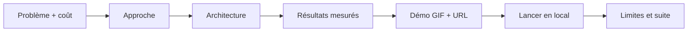

# P1-14 — README étude de cas et GIF de démo

## Ce qui a été fait
- **README réécrit au format étude de cas** : Problème (et son coût) → Approche → Architecture (Mermaid) → Résultats mesurés (tableau des trois configurations, latence en ligne, CI) → Démo (GIF + URL) → Lancer en local (3 commandes) → Limites et suite. Chaque chiffre vient d'un fichier de `eval/results/` ou d'une mesure datée sur la démo en ligne.
- **GIF de démo** (`docs/media/demo.gif`, 17 images, 161 Ko) enregistré sur le site public :
  - une question sur les examens, avec la réponse citée et son passage déplié ;
  - une question hors des documents, avec l'abstention.
  - Il est produit par un script qui pilote Microsoft Edge (Playwright, fenêtre de 760 × 640) et assemble les captures avec Pillow ; ce n'est donc pas une maquette.
- **Deux images fixes** pour les publications : `docs/media/reponse-citee.png` et `docs/media/abstention.png`.
- **`scripts/prepare.py`** : téléchargement des PDF, découpage et index en une commande, pour tenir le « lancer en local en 3 commandes ». Vérifié en local : 546 passages, index construit.

## Pourquoi ce choix plutôt que l'alternative courante
- **Un README qui raconte un problème et des mesures plutôt qu'une liste de technologies.** Un recruteur lit les trente premières secondes : il voit le GIF, le problème et un tableau chiffré avec ses intervalles. La stack apparaît dans l'approche, au service du problème.
- **Une vraie capture du site en ligne plutôt qu'une maquette.** Le GIF montre aussi l'abstention, qui est la proposition de valeur du projet, et pas seulement un cas où tout va bien.
- **Les limites dans le README lui-même**, pas seulement dans le rapport : latence, taille du jeu, hébergement de substitution. Elles seront de toute façon posées en entretien ; autant montrer qu'elles sont connues et chiffrées.

## Schéma

## 5 questions d'entretien
1. **Présente Le Classeur en 30 secondes.**
   C'est un assistant qui répond aux questions sur des règlements en citant la page exacte du document officiel, et qui dit « je ne sais pas » quand la réponse n'y est pas. Sur 60 questions évaluées, il répond juste dans 70 % des cas contre 42,5 % pour une base naïve, sans aucune réponse fausse, et s'abstient sur les 20 questions hors corpus. Il est en ligne, évalué en CI à chaque changement, et déployé par Terraform.
2. **Quelle a été la décision technique la plus importante ?**
   Mesurer la récupération au niveau de la page. C'est ce qui a montré que l'assistant refusait parce qu'il ne trouvait pas la bonne page, et pas à cause du prompt. D'où la recherche hybride puis le reranker, qui ont fait passer la bonne page récupérée de 62,5 % à 95 %.
3. **Qu'est-ce que tu referais autrement ?**
   Fixer plus tôt un jeu de validation distinct, pour ne prendre aucune décision après avoir vu le jeu de test. Et mesurer la latence sur la machine cible dès le début, au lieu de la découvrir au déploiement.
4. **Comment as-tu produit le GIF ?**
   Avec un script qui pilote Edge en mode automatisé : il tape une question sur le site en ligne, attend la réponse, déplie le passage, pose une question hors corpus et capture chaque étape. Le résultat est reproductible et montre le vrai comportement, latence comprise.
5. **Que faudrait-il pour mettre Le Classeur en production dans une entreprise ?**
   Ses propres documents (avec authentification et droits d'accès par document), une mise à jour automatique du corpus, une latence réduite (GPU ou reranker plus léger), un stockage partagé pour les limites, et un suivi de la qualité en production à partir des traces et de retours utilisateurs.
