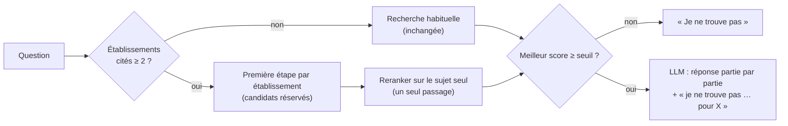

# P1-15 — Questions sur plusieurs établissements

## Le problème, signalé en testant le site
« Quelle est la moyenne pour que je réussisse mon année scolaire à l'UBO et à l'ENIB ? » donnait « Je ne trouve pas cette information dans les documents ». Le règlement des études de l'UBO contient pourtant la réponse (10/20).

Le diagnostic, mesuré en local avec la question exacte :
- **le score du reranker est dilué**. Il note la question entière face à chaque passage. Avec deux établissements, le meilleur passage (la bonne page de l'UBO) tombe à −3,83, sous le seuil d'abstention (−2,36), et Le Classeur s'abstient sans même appeler le LLM. Avec le sujet seul (« Quelle est la moyenne pour que je réussisse mon année scolaire ? »), la même page obtient −1,86 ;
- **les candidats d'un établissement peuvent manquer**. Les 20 candidats relus par le reranker viennent souvent d'un seul établissement ;
- **la réponse ne peut être que totale**. La consigne et la détection d'abstention traitaient toute phrase « je ne trouve pas » comme un refus global, citations effacées.

## Ce qui a été fait
- **Repérage des établissements cités** (`etablissements.py`) : ENIB / Bretagne INP, Université de Brest (UBO) et IMT Atlantique. Chaque source du corpus est rattachée à exactement un établissement, ce que vérifie un test.
- **Recherche par établissement** (seulement quand au moins deux établissements sont cités) :
  - pour chaque établissement, la première étape (dense + BM25) cherche la question restreinte à cet établissement et réserve ses candidats : 20 au total, répartis entre les établissements ;
  - le reranker note le **sujet seul**, en un seul passage, donc au même coût qu'une question simple ;
  - le seuil d'abstention s'applique, comme avant, au meilleur passage de la question ;
  - le LLM reçoit les meilleurs passages de chaque établissement.
- **Réponse partielle** : pour ces questions seulement, une consigne dédiée demande au LLM de répondre aux parties couvertes, avec citations, puis d'écrire pour chaque partie manquante « Je ne trouve pas cette information dans les documents pour … ». L'abstention n'est plus comptée que si la réponse ne contient rien d'autre. Le champ `partial` de l'API le signale, et l'interface affiche alors un avertissement sous la réponse.
- **Citations au format des outils de gpt-oss** (`【1†L3-L5】`) converties en `[1]`. Ce format avait fait perdre ses citations à une réponse juste pendant les essais.
- **Jeu de questions composées** (`eval/questions_composees.jsonl`) : 8 questions et 17 parties, dont 10 avec réponse dans les documents et 7 sans. Chaque fait a été vérifié dans les PDF. Le script `scripts/eval_composees.py` note chaque partie par des règles simples.

## Résultats mesurés (8 questions composées, mêmes données, même modèle)
| | Avant | Après |
|---|---|---|
| Parties avec réponse dans les documents, répondues et citées | 1/10 | **8/10** |
| Parties avec réponse dans les documents, refusées | 8/10 | 1/10 |
| Parties sans réponse dans les documents, signalées comme telles | 7/7 | **7/7** |
| Parties sans réponse pour lesquelles une réponse est affirmée | 0 | **0** |
| Latence médiane (local, CPU) | 11,4 s | 10,7 s |

Relecture à la main des deux parties non comptées comme répondues :
- **c06, UBO (téléphone en examen)** : le fond est juste (le téléphone ne peut pas être gardé et doit être éteint). La réponse ajoute toutefois qu'il est « remis au surveillant » puis restitué, alors que la charte dit qu'il est déposé à l'entrée de la salle : c'est un détail non fondé.
- **c02, ENIB (vapotage)** : la partie est aussi refusée en question simple. Le règlement parle de « cigarette électronique », et la page n'arrive pas parmi les candidats. C'est une limite de la recherche, pas de la décomposition.

## Pourquoi ce choix plutôt que l'alternative courante
- **Une règle déterministe plutôt qu'un appel LLM pour découper la question.** Les questions qui ne citent qu'un établissement (toutes celles du jeu de 60) gardent la même recherche et le même seuil qu'avant, sans appel ni latence en plus ; leur consigne est elle aussi inchangée. Le découpage par LLM traiterait aussi les questions à plusieurs sujets (« vitesse et animaux »), au prix d'un appel par question et d'une nouvelle calibration.
- **Une consigne réservée aux questions composées.** Un premier essai l'envoyait à toutes les questions. Sur l'évaluation des 60 questions, q12 (UBO seul) a répondu « je ne trouve pas … pour UBO » au lieu des 48 heures qu'elle trouvait jusque-là. Les questions simples gardent donc exactement leur ancienne consigne. Cette régression a été trouvée parce que l'évaluation complète a été relancée.
- **Un seuil global plutôt qu'un seuil par établissement.** Un premier essai appliquait le seuil à chaque établissement. Il refusait des parties que la question simple réussissait, car le seuil a été calibré sur le meilleur passage d'une question, pas sur le meilleur passage de chaque établissement. On garde donc le seuil tel qu'il a été calibré, et le LLM juge partie par partie.
- **Mesurer avant et après sur un petit jeu dédié**, en plus de relancer l'évaluation complète des 60 questions : la consigne et la détection d'abstention changent pour toutes les questions.

## Schéma

## 5 questions d'entretien
1. **Pourquoi la question sur deux établissements échouait-elle alors que chaque partie, posée seule, pouvait réussir ?**
   Le reranker note la question entière face à chaque passage. Une question qui parle de deux établissements ressemble moins à une page qui n'en concerne qu'un : le meilleur score passait de −1,86 à −3,83, sous le seuil d'abstention. Le système s'abstenait donc avant même d'appeler le LLM.
2. **Comment évites-tu qu'une réponse partielle invente la partie manquante ?**
   Trois garde-fous. Le LLM ne reçoit que des passages, rattachés chacun à un établissement. La consigne lui impose d'écrire « je ne trouve pas … pour X » pour toute partie non couverte. Enfin, c'est mesuré : sur les 7 parties absentes des documents, aucune n'a reçu de réponse affirmée.
3. **Pourquoi ne pas avoir simplement baissé le seuil ?**
   Le seuil est calibré sur un jeu séparé, pour garder les 20 abstentions hors corpus sans refuser trop de questions légitimes. Le baisser ferait répondre le système sur des questions hors corpus. Le défaut venait de la requête envoyée au reranker, pas du seuil.
4. **Quel est le coût de cette fonctionnalité ?**
   Pour une question simple, aucun : même chemin et même latence. Pour une question composée, une première étape de recherche par établissement (embeddings et BM25, peu coûteux) et toujours un seul passage du reranker sur 20 candidats. La latence médiane mesurée reste autour de 11 s en local.
5. **Quelles sont les limites, et que ferais-tu ensuite ?**
   Seuls les établissements déclenchent la décomposition : « vitesse et animaux » n'est pas découpée. La notation automatique des parties est faite par règles sur 8 questions, donc exploratoire. Ensuite : un découpage par LLM pour les questions à plusieurs sujets, mesuré sur un jeu plus large et avec une calibration du seuil refaite.
